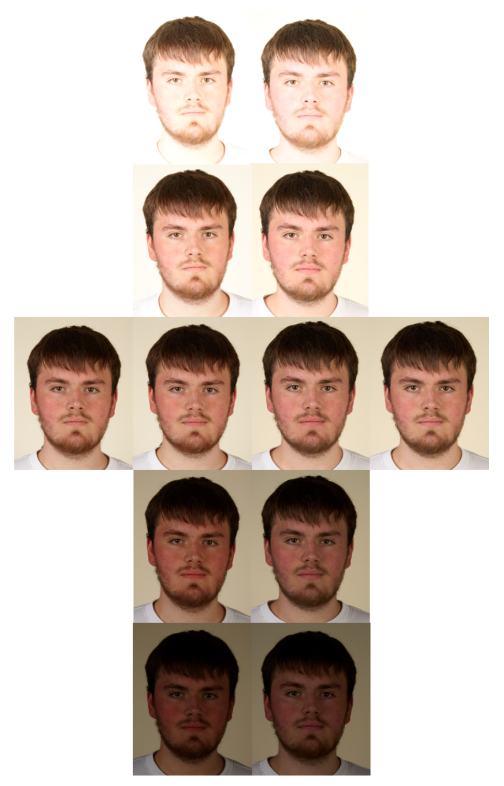

<!-- # DAST -->
<h1 align="center"> DAST: DArmstadt Skin Tone Database</h1>
<p align="center">

The DArmstadt Skin Tone (DAST) database contains portrait images from a large variety of capture subjects (light skin to dark skin). Face images are captured under controlled conditions and include ICAO compliant samples as well as systematically overexposed and underexposed images for each subject. In addition, for each subject multiple ground truth measurements for the skin tone are included. The dataset is intended to support the evaluation of demographic bias in face image quality measures and to facilitate the development and benchmarking of skin tone classification.

The acquisition protocol and dataset are described in the publication  *A Skin Tone Annotated Face Image Dataset for Studying Demographic Variability* at: https://www.christoph-busch.de/files/Busch-DAST-IWBF-2026.pdf

  <p align="center">
    <a href="https://dasec.h-da.de/staff/christoph-busch/"><strong>Christoph Busch</strong></a>
    ,
    Paul Kibler
    ,
    <a href="https://dasec.h-da.de/staff/fabian-stockhardt/"><strong>Fabian Stockhardt</strong></a>    
    ·
    <a href="https://dasec.h-da.de/staff/christian-rathgeb/"><strong>Christian Rathgeb</strong></a>    

  </p>
  <div align="center">
  </div>

## Access

The repository provides example data. The full dataset is available upon request for academic and commercial use.
Please contact Christian Rathgeb (christian.rathgeb@h-da.de) or Christoph Busch (christoph.busch@h-da.de) to receive the DAST database.

<p align="center"> 

</p>

## Dataset Overview

|Property|Description|
|-|-|
|Subjects|80|
|Images per subject|12|
|Total images|960|
|Distributed image format|TIFF|
|Image color space|sRGB at acquisition|
|Cameras|Canon EOS 50D and Sony ILCE-7M2|
|Exposure levels|EL1–EL5|
|Skin tone scale|Colorimetric Skin Tone (CST), classes 1–9 represented|
|Instrument|Cortex DSM-4 colorimeter|
|Measurements|Five anatomical sites per subject|

**Subjects per CST class:** class 1: 2; classes 2–8: 10 each; class 9: 8; class 10: 0.

## Directory Structure

The repository's example archive contains subject directories such as:

```text
example-data/
├── 001/
│   ├── Colorimeter/
│   └── Pictures/
│       └── cropped/
├── 002/
│   ├── Colorimeter/
│   └── Pictures/
│       └── cropped/
└── 036/
    ├── Colorimeter/
    └── Pictures/
        └── cropped/
```

Each numbered directory is a pseudonymous subject ID. `Colorimeter/` contains instrument measurement records; `Pictures/cropped/` contains cropped facial images. 


## Facial Images and Exposure

|Camera|Original image resolution|
|-|-|
|Canon EOS 50D|3168 × 4752 px|
|Sony ILCE-7M2|4000 × 6000 px|

Images were captured in sRGB, stored losslessly as TIFF, and manually cropped to the facial region (approximately 2300 × 2500 px). White balance was calibrated with a white balance card.

Each subject has 12 images: four nominally exposed, four underexposed, and four overexposed images. The **exposure labels below follow the paper's prose**:

|Level|Condition|Relative nominal exposure|Aperture|Shutter|ISO|
|-|-|-|-|-|-|
|EL1|Strongly underexposed|25% (−2 stops)|f/16|1/100 s|100|
|EL2|Underexposed|50% (−1 stop)|f/22|1/100 s|100|
|EL3|Nominal|100% (0 stops)|f/11|1/100 s|100|
|EL4|Overexposed|200% (+1 stop)|f/11|1/125 s|100|
|EL5|Strongly overexposed|400% (+2 stops)|f/11|1/160 s|100|

Exposure was controlled using camera and flash settings.

## Colorimeter Measurements

The Cortex DSM-4 uses D65 illumination and was calibrated daily using the manufacturer's calibration plate. Five skin measurements were made per subject. The instrument export may use generic `Measure N` labels instead of anatomical abbreviations; the mapping is:

|Export label|Measurement|Anatomical site|identifier|
|-|-:|-|-|
|LH / Measure 1|1|Left hand (interosseous region)|CLI|
|LW / Measure 2|2|Left cheek|CLC|
|S / Measure 3|3|Forehead|CFH|
|RW / Measure 4|4|Right cheek|CRC|
|RH / Rh / Measure 5|5|Right hand (interosseous region)|CRI|

Each measurement row contains a timestamp and colorimetric measurements including CIELAB (`CIE-L\*`, `CIE-a\*`, `CIE-b\*`), CIE XYZ (`X`, `Y`, `Z`), melanin and erythema indices. In the supplied DSM-4 export, XYZ values are consistent with a reference-white normalization of **Y = 100**. The XYZ/Lab pairs are consistent with a **D65 / CIE 1964 10°** white point (approximately Xn = 94.811, Yn = 100, Zn = 107.304); the observer setting is inferred from exported values, not independently confirmed in the instrument documentation.

### CST Classification

The mean CIELAB vector from the **three facial sites** (LW, S and RW; measurements 2–4) is assigned to the nearest of the ten CST class centroids defined by Cook et al. Class reference values: [CST centroid data](https://github.com/TheMdTF/mdtf-public/blob/master/datasets/skintone/data/colorimetric_scale.csv).

## Metadata and Record Linkage

The dataset includes CSV metadata associating pseudonymous subject IDs with image files, camera information and acquisition conditions. Colorimeter records are stored in each subject's `Colorimeter/`

## Citation 

If you use this work in your publication, please cite the following publications:

```
@inproceedings{Busch-DAST-IWBF-2026,
 Author = {C. Busch and P. Kibler and F. Stockhardt and C. Rathgeb},
 Booktitle = {14th Intl. Workshop on Biometrics and Forensics {IWBF}},
 Publisher = {IEEE},
 Title = {A Skin Tone Annotated Face Image Dataset for Studying Demographic Variability},
 Year = {2026}
}```

